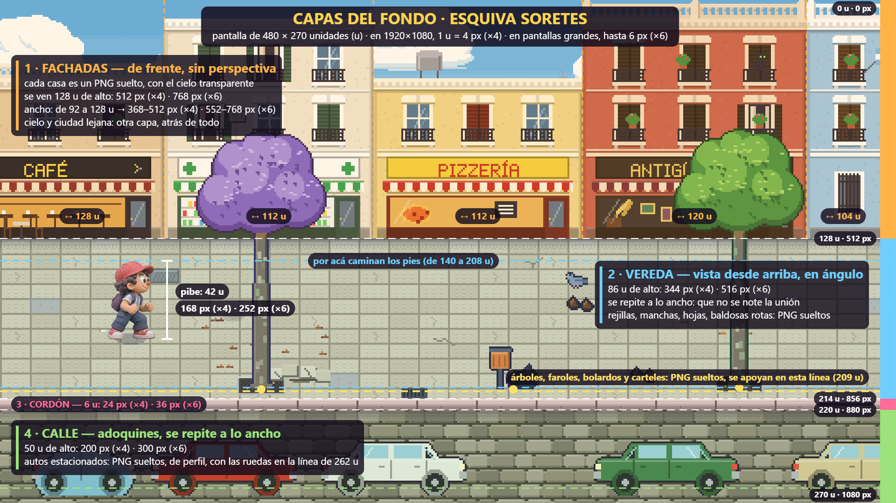

# Arte del juego

Acá van los **dibujos originales** del juego (ilustraciones grandes) y las guías
para pedirlos. El juego no los usa directamente: un conversor los limpia y los
lleva al tamaño del juego (por ahora, los personajes, en
`public/assets/characters/`).

## La estética: plastilina

La estética definitiva es la de `source/estetica-fondo.png` y
`source/estetica-fondo-con-pibe.png`: muñecos y maqueta de **plastilina**, con
textura y marcas de dedos, luz cálida de atardecer y colores porteños
(adoquines, baldosas, faroles, toldos a rayas, paredes descascaradas). El pibe
ya está hecho así (`source/pibe-plastilina-*.png`) y es el único dibujo
definitivo. El resto (fachadas, vereda, autos, soretes y los otros personajes)
es provisional, en pixel art.

**En el juego los fondos van de frente**, no en perspectiva como en esas dos
imágenes: las fachadas se ven derechas y la vereda, como en el juego de ahora.
De las referencias se toman el material, la luz y los colores, no el ángulo.

## Resolución

El juego se diseña en una pantalla de **480×270 unidades (u)** y se dibuja con
la resolución real de la pantalla: en una de 1920×1080 cada unidad son 4
píxeles (**×4**); en las más grandes, hasta 6 (**×6**, 2880×1620). Para que un
dibujo se vea nítido tiene que tener **entre 4 y 6 píxeles por unidad**: el
mínimo es ×4 y lo ideal, ×6. Con menos, el juego lo agranda y se ve borroso.

## Fondos de frente



`guia-capas-fondo.png` es una captura del juego con cada capa marcada. Las
capas, de atrás para adelante (medidas en píxeles):

| Capa | Cómo es | En el juego | ×4 (mínimo) | ×6 (ideal) |
| --- | --- | --- | --- | --- |
| Cielo | Fijo, atrás de todo. Se ve arriba de las casas bajas y en las esquinas. Uno por ambiente: día, atardecer, noche y nublado. | 480 × 270 u | 1920 × 1080 | 2880 × 1620 |
| Ciudad lejana | Siluetas de edificios, cúpulas y tanques. Se mueve más lento que la calle y se repite a lo ancho. | 480 × 128 u | 1920 × 512 | 2880 × 768 |
| Fachadas | Una casa por imagen, de frente, con el cielo transparente y la base recta. | 92–128 u de ancho; se ven los 128 u de abajo | 368–512 de ancho; 512 de alto visibles | 552–768 de ancho; 768 visibles |
| Vereda | Baldosas vistas desde arriba, en ángulo (como ahora). Se repite a lo ancho. | 86 u de alto | 344 de alto | 516 de alto |
| Cordón | El frente del cordón. Se repite a lo ancho. | 6 u | 24 | 36 |
| Calle | Adoquines. Se repite a lo ancho; los autos van aparte. | 50 u | 200 | 300 |
| Esquina (fin de cuadra) | La calle que cruza, con la senda peatonal, vista desde arriba. | 112 × 170 u | 448 × 680 | 672 × 1020 |
| Cruce con semáforo | Ochavas, calzada y senda. Los semáforos y los autos que cruzan van aparte. | 140 × 214 u | 560 × 856 | 840 × 1284 |

Vereda, cordón y calle pueden venir juntos, en una sola tira de 142 u de alto
(568 px ×4, 852 px ×6).

### Fachadas

- Se ve la franja de abajo, de **128 u**: la base de las casas está en la línea
  de 128 u y lo que sobresale por arriba de la pantalla no se ve.
- **Proporciones realistas** (decidido en noviembre de 2026): si el pibe (42 u)
  mide alrededor de 1,35 m, un metro son unas 31 u. Una puerta de 2,2 m mide
  unas 68 u (272 px ×4, 408 px ×6) y una planta baja de 4 m, unas 124 u: en la
  franja de 128 u entra casi sólo la planta baja, como en las imágenes de
  referencia. Las medidas finales se ajustan con la hoja de proporciones (abajo).
- Las fachadas provisionales de pixel art todavía usan las proporciones viejas
  (planta baja de 46 u y pisos de 32 u, con puertas de la mitad del pibe): no
  sirven de modelo para el arte nuevo.
- Hoy hay 14 casas (casa rosa, kiosco, verdulería, garage, antigüedades, casa
  ocre, almacén, bar, casa terracota, pizzería, farmacia, paredón, casa celeste
  y casa bordó) y 2 esquinas de 128 u: el café con cúpula del principio y del
  final de cada cuadra. Las versiones de noche, con las ventanas prendidas, son
  opcionales.

### Objetos sueltos

Cada uno es una imagen aparte, de frente y con fondo transparente, cortada justo
donde toca el piso. El juego los ubica y decide si el pibe pasa por delante o
por detrás.

| Qué | En el juego | ×4 | ×6 |
| --- | --- | --- | --- |
| Árbol (copa de ~46 × 50 u y tronco de ~16 × 82 u) | ~46 × 132 u | 185 × 530 | 280 × 800 |
| Farol | 16 × 82 u | 64 × 328 | 96 × 492 |
| Auto estacionado, de perfil | 56–78 × 32 u | 225–310 × 130 | 335–470 × 190 |
| Vecino, paseador, perro (con animación) | 26 × 40 u | 105 × 160 | 160 × 240 |
| Sorete común / gigante | ~16 × 10 u / ~30 × 24 u | 64 × 40 / 120 × 96 | 96 × 60 / 180 × 144 |

- Árboles, faroles, bolardos y carteles se apoyan en la línea de **209 u**,
  junto al cordón. Para los objetos chicos (bolardos, tachos, cajones,
  macetas), medilos contra el pibe en la guía.
- Los autos estacionados apoyan las ruedas en la línea de **262 u**. Hoy hay 8
  modelos.

### Carteleras para publicidad

El juego va a mostrar avisos en el escenario: carteleras en los paredones, la
parte de atrás de los kioscos de diarios, el panel de los refugios de
colectivo, pantallas en el centro, el costado de los colectivos... Para eso:

- Dibujá la cartelera **vacía**: el marco y, adentro, un rectángulo liso de un
  solo color. El juego pone el aviso adentro (y lo cambia sin tocar el dibujo).
- Usá formatos comunes, así sirven los avisos de cualquier anunciante:
  **horizontal 2:1** (cartelera de paredón o de kiosco), **vertical 2:3**
  (refugio de colectivo) y **16:9** (pantalla).
- Mejor como pieza aparte (un kiosco con su cartelera, un refugio) que pintada
  dentro de una fachada: así el juego decide dónde va cada una.

### Cómo mandarlos

- **Primero Versalles**, el barrio de prueba; después San Telmo y esa zona.
- **Cada pieza por separado** (una fachada por imagen, la vereda, cada árbol,
  cada objeto), y junto con ellas **una hoja con los personajes al lado de
  algunas piezas** (una puerta, un auto, un árbol) para ver las proporciones.
- Si partís de fotos de la calle, que sean bien de frente y con luz pareja;
  después se pasan a plastilina con la misma luz para todas.

### Cómo pedirlos (a una IA o a un ilustrador)

- **Vista de frente, sin punto de fuga.** La vereda y la calle se ven desde
  arriba, en ángulo, pero también sin fuga: las líneas de las baldosas, paralelas.
- **El mismo material y la misma luz en todas las piezas**: plastilina y luz
  cálida que viene siempre del mismo lado.
- **Fondo transparente** (o un color plano que el dibujo no use, como verde
  chillón), sin halos ni sombras sobre el fondo.
- **Una pieza por imagen**, con un margen chico alrededor.
- **Las piezas que se repiten** (vereda, cordón, calle, ciudad lejana) tienen
  que empalmar: lo que sale por el borde derecho sigue por el izquierdo.
- **Grandes**: al menos ×4; lo ideal, ×6 (ver las tablas).
- Guardalas en `art/source/` con nombres claros: `fachada-kiosco.png`,
  `vereda.png`, `arbol-1.png`...

## Logo de la portada

El logo animado (de plastilina: el sorete salta y el farol titila) está en
`source/logo.gif` y sus cuadros, en `source/logo/`. Para actualizarlo:

```bash
npm run logo                 # arma public/assets/ui/logo.png con los cuadros de source/logo/
```

El conversor suaviza el borde y avisa si los cuadros son chicos. El juego y la
portada usan esa misma hoja **en WebP** (pesa la cuarta parte):
`public/assets/ui/logo.webp` y `sitio/logo-animado.webp`. Se generan a partir
de `public/assets/ui/logo.png` con cualquier conversor a WebP que conserve la
transparencia (por ejemplo, squoosh.app). Para que se
vea nítido en pantallas grandes conviene mandarlo **de 1200 px o más, en PNG
con fondo transparente** y, si es animado, **un PNG por cuadro** (el GIF tiene
256 colores y el borde serruchado). En el menú se muestra de 104 unidades de
alto (`LOGO_UNITS` en `src/assets/manifest.ts`).

## Personajes

Cada personaje viene en **cinco imágenes, una por animación**, como el pibe:

| Imagen | Poses | Qué usa el juego (fila.columna) |
| --- | --- | --- |
| `caminar` | 8 (2 filas de 4) | los 8 pasos de caminar |
| `correr` | 8 (2 filas de 4) | los 8 pasos de correr |
| `saltar` | 6 (2 filas de 3) | preparar el salto (0.0), subir (0.2), bajar (1.1) y festejar (1.0 y 0.2) |
| `poder` | 6 (2 filas de 3) | quieto (0.0, que también es el retrato), respirar (1.2) y el poder (0.2) |
| `sorete` | 8 (2 filas de 4) | el susto (0.1), el pie levantado (0.3), mirar la suela (1.0), el asco (1.1) y mareado (0.2) |

Si los próximos personajes vienen con las poses en ese mismo orden, sirve la
configuración del pibe cambiando sólo los nombres de los archivos.

- **Tamaño:** en las imágenes del pibe cada pose mide entre 350 y 450 px de
  alto, y así se ve nítido hasta en pantallas ×6 (el personaje mide 42 u: 168 px
  en ×4 y 252 px en ×6). Mínimo: 170 px por pose; para ×6, 250 px o más.
- **Fondo transparente de verdad** (o un color plano que el personaje no use),
  sin bordes ni halos de otro color.
- **Todas las poses mirando a la derecha** (el juego las da vuelta para ir a la
  izquierda) y, en cada fila, con los **pies sobre la misma línea**.
- **El mismo personaje y del mismo tamaño en las cinco imágenes**: ropa,
  mochila, peinado y proporciones iguales (con IA estos detalles suelen cambiar
  y al animar parpadean). Si una imagen viene a otro tamaño, se corrige con
  `"scale"`: en el pibe, `saltar` vino un 7 % más chica y `sorete`, un 12 %.
- **Zapatillas limpias**: las versiones sucias las hace el conversor.
- **Retrato** (selección de personaje): sale de una pose (en el pibe, la
  primera de `poder`) o de una imagen aparte de cuerpo entero, de unos 460 px
  de alto (76 u).

## Convertir las imágenes de un personaje

```bash
npm run sprites -- scripts/sprites/pibe.json --debug
```

Genera, en `public/assets/characters/`:

- `<look>-0@4.png`, `-1@4` y `-2@4` (y los `@6`), cada uno con su `.json`:
  zapatillas limpias, una sucia y dos sucias, en cuadros de 192×192 (×4) y de
  288×288 (×6). El juego descarga los del tamaño que necesita su pantalla.
- `<look>-portrait.png`: el retrato.

Con `--debug` además genera, en `art/debug/` (no se sube al repositorio):

- `<look>-<imagen>-segments.png`: cada imagen con sus poses numeradas como
  `fila.columna` (para completar la configuración).
- `<look>-0-x4.png` (y `-1`, `-2`): los cuadros convertidos, ampliados.
- `<look>-portrait-check.png`: el retrato sobre fondo oscuro y claro, para
  revisar que no le queden bordes del fondo original.

Después se declara el personaje en `src/assets/manifest.ts`:

```ts
...characterArt('piba', [4, 6]),
characterPortrait('piba'),
```

El look es el de `src/graphics/characterLooks.ts`: `pibe`, `piba`, `skater`,
`runner`, `portero`, `vieja`, `paseador` o `policia`. Si un look tiene sus
hojas, el juego usa ese dibujo en todos lados (partida, menú, selección, barra
de progreso, mapa y avatar online); si no, el provisional.

### La configuración (`scripts/sprites/<look>.json`)

```jsonc
{
  "look": "pibe",
  // "smooth" conserva el sombreado de la ilustración; "pixel" la pasa a pixel art.
  "style": "smooth",
  // Genera hojas para pantallas ×4 y ×6.
  "renderScales": [4, 6],
  // Alto del personaje en el juego (unidades) y cuadro que define la escala.
  "targetUnits": 42,
  "reference": "idle0",
  // Limpieza: transparencia mínima y color del borde que dejó el recorte (acá, rojo).
  "clean": { "minAlpha": 128, "fringe": { "minR": 200, "maxG": 60, "maxB": 60, "maxAlpha": 250 } },
  // Separación de los dibujos: área mínima y distancia para unir pedacitos sueltos.
  "minArea": 300,
  "mergeGap": 12,
  // Una imagen por animación; "scale" corrige una imagen dibujada a otro tamaño.
  "sheets": {
    "caminar": { "source": "art/source/pibe-plastilina-caminar.png" },
    "saltar": { "source": "art/source/pibe-plastilina-saltar.png", "scale": 1.07 }
  },
  // El retrato sale de una pose.
  "portrait": { "sheet": "poder", "sprite": [0, 0] },
  // Cuadro del juego → [imagen, fila, columna]. También admite
  // { "sheet", "sprite": [fila, columna], "scale", "flip", "nudge" (corrimiento) }.
  "frames": {
    "idle0": ["poder", 0, 0],
    "walk0": ["caminar", 0, 0]
  }
}
```

Cuadros que usa el juego: `idle0`, `idle1`, `blink`, `walk0`…`walk7` (4 a 8),
`run0`…`run7` (4 a 8), `jumpPrep`, `jumpUp`, `jumpDown`, `special0` (su
poder), `stepShock` y `stepLift` (pisar un sorete), `stepLook` y `stepDisgust`
(mirar la suela, asco), `dizzy` (mareado) y `win0`, `win1` (festejo).

La configuración de una sola hoja grande (`"source"`, `"region"`,
`"renderScale"`, `"targetHeight"`) también funciona: es la de la ilustración
anterior del pibe, guardada en `scripts/sprites/pibe-ilustracion.json` junto
con su hoja, `source/pibe-sheet.png`.
